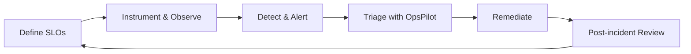

<div align="center">


<a href="https://readme-typing-svg.demolab.com">
  
</a>

<br/><br/>

<a href="https://www.shaikdavudh.dev/"></a>
<a href="https://www.shaikdavudh.dev/blogs"></a>
<a href="https://www.linkedin.com/in/shaikdavudh11/"></a>
<a href="https://x.com/Shaikdavudh11"></a>
<a href="mailto:dev.shaikdavudh@gmail.com"></a>

</div>

<br/>

## 👋 About Me

I build **resilient cloud infrastructure**, **self-healing distributed systems**, and **AI-powered operational tools**. I care about infrastructure that is declarative, observable, and boring in production, so that incidents are rare and short.

```yaml
focus:
  - Infrastructure as Code (Terraform, CloudFormation)
  - Kubernetes workload orchestration & GitOps
  - Observability, SLOs & incident response
  - AI-assisted incident triage (reducing MTTR)
building:   OpsPilot
based_in:   Bengaluru, India
open_to:    SRE / Platform / DevOps roles, and conversations about distributed systems
```

---

## 🚀 Featured Projects

<table>
<tr>
<td width="50%" valign="top">

### 🤖 [OpsPilot](https://github.com/Shaikdavudh11/OpsPilot)
**AI-powered DevOps & SRE incident assistant**

Parses logs, container crash dumps, and cloud events, then correlates Kubernetes events to isolate root causes, with answers grounded in evidence rather than guesses.


</td>
<td width="50%" valign="top">

### ☁️ [Three-Tier AWS Infrastructure](https://github.com/Shaikdavudh11/Three-Tier-Application-Deployment-on-AWS)
**Production-grade multi-tier architecture as code**

Multi-AZ VPC segmentation, autoscaling, ALBs, and secure RDS, with least-privilege IAM, isolated subnets, and automated CI/CD.


</td>
</tr>
<tr>
<td colspan="2" valign="top">

### 📚 [Engineering Evidence & Case Studies](https://github.com/Shaikdavudh11/shaik-engineering)
Architectural decisions, deployment benchmarks, and operational runbooks documenting production-proven patterns.

</td>
</tr>
</table>

---

## 🧭 How I Think About Reliability



---

## 🛠️ Tech Stack

<div align="center">

| | |
| :--- | :--- |
| **☁️ Cloud** |   |
| **🏗️ IaC** |    |
| **📦 Containers** |     |
| **⚙️ CI/CD** |    |
| **📈 Observability** |    |
| **💻 Languages** |     |

</div>

---

## 📊 GitHub Stats

<div align="center">


</div>

---

## ✍️ Writing

I write about architecture patterns, incident lessons, and the reasoning behind infrastructure decisions.

- 📝 **Blog:** [shaikdavudh.dev/blogs](https://www.shaikdavudh.dev/blogs)
- 📰 **Medium:** [medium.com/@shaikdavudh11](https://medium.com/@shaikdavudh11)

---

## 🤝 Let's Connect

Always up for conversations about distributed systems, platform engineering, and cloud architecture.

**📧** [dev.shaikdavudh@gmail.com](mailto:dev.shaikdavudh@gmail.com) &nbsp;•&nbsp; **💼** [LinkedIn](https://www.linkedin.com/in/shaikdavudh11/) &nbsp;•&nbsp; **🐦** [X](https://x.com/Shaikdavudh11) &nbsp;•&nbsp; **🌐** [Portfolio](https://www.shaikdavudh.dev/)

<div align="center">

<br/>

*"Simplicity is prerequisite for reliability."* — Edsger W. Dijkstra


</div>
