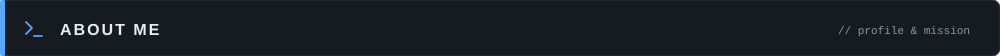
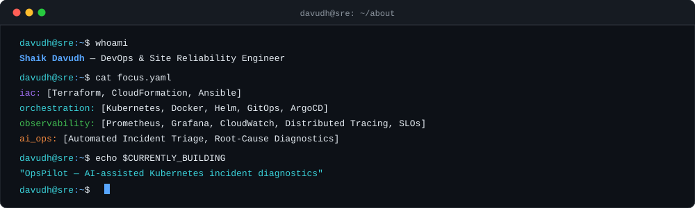
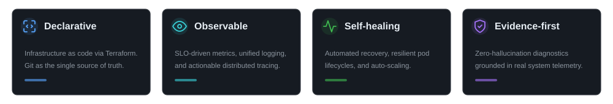
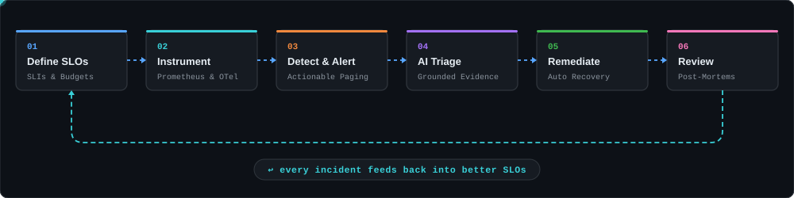
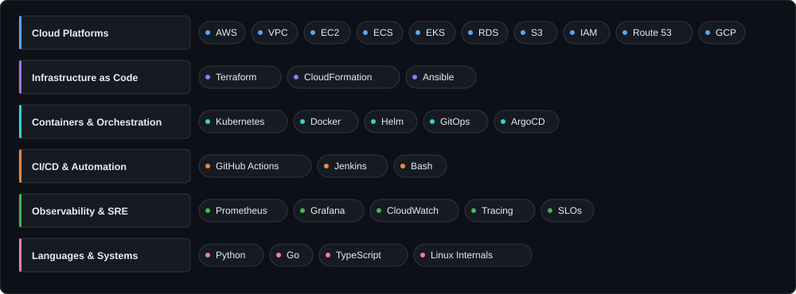
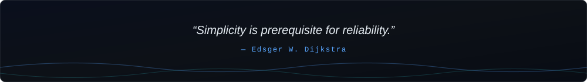

  

  

 

  

  

  

  

  

  

  

  

 

I write about architecture patterns, incident lessons, and the reasoning behind infrastructure decisions.

  

  
  

 

 

Open to conversations about distributed systems, platform engineering, and cloud architecture.

  

  
  
  

  

